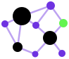
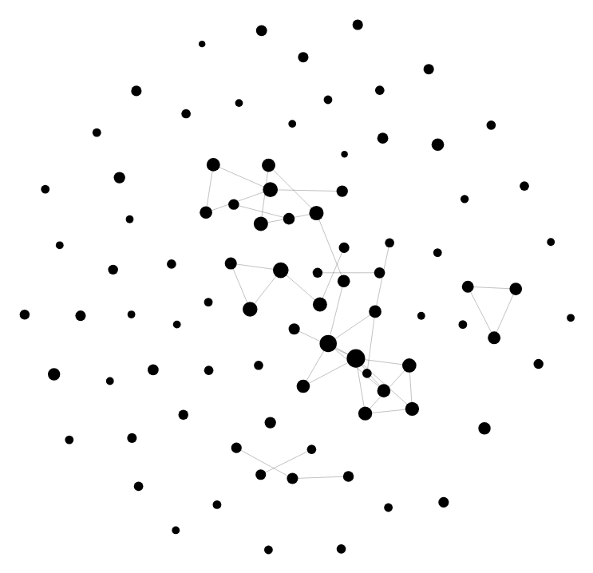
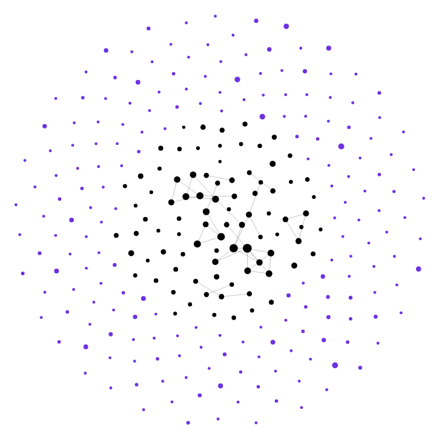
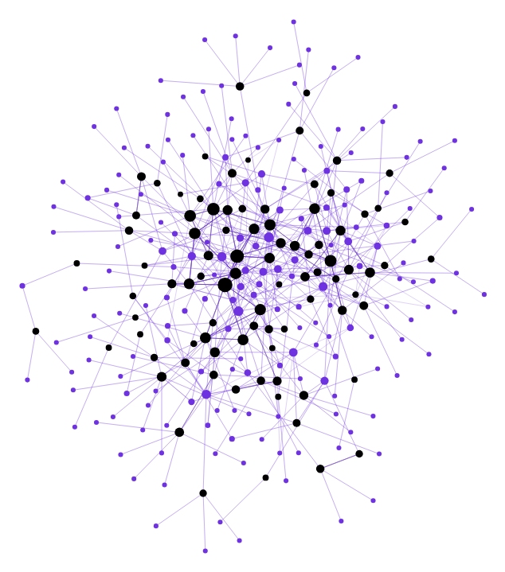

# vault2kg 

Point it at an Obsidian vault and get a knowledge graph, ready for Neo4j, LightRAG or a viewer in your browser.

```bash
pip install pyyaml
python src/vault2kg.py ~/Documents/MyVault
```

Your vault already holds most of a graph: `[[links]]` are edges, frontmatter is properties, tags are categories. vault2kg reads all of that without an LLM, and uses an LLM only for what's in the text of each note. The result is one file, `graph.json`, that the other scripts load into Neo4j or LightRAG.

<table>
<tr>
<td align="center" valign="bottom" width="33%"><br><sub><b>1. From the vault, no LLM</b><br>notes and their links</sub></td>
<td align="center" valign="bottom" width="33%"><br><sub><b>2. Entities in the text</b><br>found by the LLM, shown unconnected</sub></td>
<td align="center" valign="bottom" width="33%"><br><sub><b>3. The full graph</b><br>with the LLM's relationships</sub></td>
</tr>
</table>
<p align="center"><sub>A real vault of 88 notes in <code>src/kg_view.py</code>, names hidden: notes in black, entities in violet. Steps 1 and 2 are the same graph with the viewer's "Entities" and "Extracted by LLM" switches turned off. Entities and their relationships come from the same LLM step; step 2 only separates them to show what was found.</sub></p>

## From vault to answers: a worked example

This repository includes `examples/demo_vault/`: eight numbered notes from a fictional "Lab Methods Handbook", structured as the [vault guide](guides/VAULT_GUIDE.md) recommends. That structure comes from a real vault we tested on. Each note has its number in the title and its facts in the frontmatter, repeats the facts that should become relationships as `**Label:** value` lines, and has free text under a heading and links to related notes:

```markdown
---
item_id: "1.1.2"
team: "Imaging"
risk: "R2"
systems: "Lab server AND GPU node"
source_document: "Lab Methods Handbook.pdf"
---
# 1.1.2. Keypoint Extraction

**Team:** Imaging
**Risk:** R2

**Systems:** Lab server AND GPU node

## Method

MediaPipe extracts body keypoints from every video that 1.1.1 accepted; final analyses use ViTPose,
because MediaPipe loses the wrist during fast releases. Results go to the data warehouse …

## Linked with

- [[1.1.1 - Video Intake]]
- [[1.2.1 - Release Timing]]

---
Source: Lab Methods Handbook.pdf, section 1.1.2, page 4.
```

The output below comes from real runs on an 8 GB GPU (Qwen3-4B-AWQ and bge-base-en-v1.5, see [vLLM in Docker](#vllm-in-docker)).

### 1. Build the graph

```bash
python src/vault2kg.py examples/demo_vault
```

```
LLM: vLLM · Qwen/Qwen3-4B-AWQ · BAAI/bge-base-en-v1.5 for merging duplicates
Reading demo_vault: 8 notes, 10 sections
Extracting entities from 8 sections (0 cached)
Done in 9s: 8 notes, 13 entities, 0 tags, 73 relationships
```

What each part of the notes became:

| In the notes | In the graph |
|---|---|
| `[[links]]` under "Linked with" | an edge per link, without the LLM |
| `**Team:**` and `**Systems:**` lines | every method linked to its team (8 of 8) and its systems (12 of 12) |
| the free text | MediaPipe and ViTPose as tools: Keypoint Extraction `USES` both |
| `risk: "R2"` | a property, filterable in Neo4j; codes rarely become nodes (see the guide) |
| `1.1.2` in the title | an alias, so "see 1.1.2" in any note resolves to it |
| the source footer | hidden from the LLM as template text, kept in the note and its passages |

To look at it: `python src/kg_view.py examples/demo_vault-kg --open`.

### 2. Load it into LightRAG and ask

```bash
pip install lightrag-hku openai
python src/kg_to_lightrag.py examples/demo_vault-kg --working-dir ./rag
python src/kg_to_lightrag.py --working-dir ./rag --query "Which methods belong to the Imaging team, and what do they do?"
```

```
Inserted 21 entities, 30 relationships, 25 chunks into LightRAG at ./rag
Linked all passages for 17 entities and 25 relationships

### Methods Belonging to the Imaging Team                      (answer shortened)
- Video Intake: This method involves filming trials using a camera rig and copying the videos to the lab server. …
- Keypoint Extraction: This method focuses on extracting body keypoints from videos using tools like MediaPipe and ViTPose. …
- Equipment Booking: This method involves booking the camera rig and GPU node using a shared calendar. …
- Shared Calendar: The Imaging team uses the shared calendar for equipment booking …
```

All three Imaging methods are there. The 4B model also listed the shared calendar, which is a system, as a fourth.

### Your own vault

Run vault2kg on it as it is: it handles links, frontmatter, template text and numbered titles on its own. The [vault guide](guides/VAULT_GUIDE.md) shows what to change in your notes, or in the converter that writes them, to get a better graph.

**Optional: the vault-prep skill.** [`skills/vault-prep`](skills/vault-prep/SKILL.md) is an agent skill that turns frontmatter values into links (`team: "[[Imaging]]"`), with your approval at every step and a backup first. That makes those relationships certain without an LLM, codes like `R2` included. The trade-off, measured on the demo vault: once a note's facts are all links, a 4B model mostly repeats those names and missed MediaPipe and ViTPose in the text. Use it with a strong model, or for facts you need complete. Copy the folder into `.claude/skills/` (Claude Code) or give it to any agent that reads `SKILL.md` files; without an agent, run its two scripts yourself.

### What the graph adds: results on a real vault

A demo this small can be answered by vector search alone. The difference shows on a real vault: 88 notes generated from an internal PDF that describes project ideas, with a numbered title, a service, a risk level and data sources per note. Same 8 GB setup, vault not prepared, no flags. LightRAG's `mix` mode uses the graph and the passages; `naive` uses the passages only.

| Question | In the vault | `naive` | `mix` | `mix --rerank` |
|---|---|---|---|---|
| Which projects belong to the workshop service? | 8 notes have that service | 6 of 8 found, 4 wrong | **all 8 found**, 3 wrong | **all 8 found**, 2 wrong |
| Which projects use the data warehouse, and for what? | 15 notes mention it | 9 of 15 found, 1 wrong | 9 of 15 found, 1 invented | **10 of 15 found, none wrong** |
| Is adfinity used in any solutions using LangChain? | 1 note mentions LangChain and is 2 hops away from adfinity via a solution | 0 of 1 found, 2 wrong | **1 of 1 found**, 0 wrong | **1 of 1 found**, 0 wrong

- **The service question** is where the graph helps. The LLM linked 82 of the 88 notes to their service, and the service is in each note's description, so `mix` reached all 8. Vector search found 6 and added 4 that only sounded similar. The `**Service:**` line in every note is what made those links; the [vault guide](guides/VAULT_GUIDE.md) explains why.
- **The data-warehouse question** is a tie, but the two modes found different notes: 12 of 15 between them. The limit was the model's 8,192-token context. LightRAG found 66 entities and 79 relationships, and only 17 and 34 of them fit into the answer's context.
- **The solution question** is where the knowledge graph shines. The LLM linked adfinity (entity) to a solution, which in turn was linked to the LangChain entity. During the mix query, the knowledge graph worked out the relationship between both entities and found the solution that links them. The naive mode hallucinated two wrong solutions that have nothing to do with LangChain.
- **Wrong and invented entries** come from the 4B model writing the answer.
- **The optional reranker** ([below](#reranking-optional)) helped on the first two questions: it chose better passages for the small context, and the answers named fewer wrong projects. One run per question, so read it as a direction, not a benchmark.

For complete lists ("every project with risk R3"), use Neo4j: it filters exactly, where LightRAG ranks.

## Use a strong model

Everything above runs on a 4B model on an 8 GB laptop GPU, so you can try it anywhere. The quality follows the model, though:

- **vault2kg:** a strong model finds more of what's in the text and follows the extraction rules more closely. A small one tends to repeat the names it was given and miss new ones: on the demo vault prepared by the skill, the 4B model missed MediaPipe and ViTPose. Use at least a 7B model (`docker-compose.vllm.yml`) or a hosted one.
- **The vault-prep skill**, if you use it: it decides what becomes a relationship, and you run it once. Use the strongest model you can.
- **kg_to_lightrag:** the chat model extracts the question's keywords and writes the answer, and LightRAG fits what it retrieved into that model's context. A model with 32k tokens or more keeps far more of the graph in the answer, and invents less.

`docker-compose.vllm-8gb.yml` is for trying it out; for real use, take `docker-compose.vllm.yml` (24 GB) or a hosted model.

## What you get

The result goes into a folder next to the vault, `MyVault-kg/`:

- **`graph.json`**: the knowledge graph (nodes, edges, text chunks). The format is in [GRAPH_FORMAT.md](guides/GRAPH_FORMAT.md).
- **`notes/`**: one JSON per note, listing what was found in that note.

That's all the main script does. Everything else is a separate, optional script, and each one declares its own dependency:

| Script | Does | Needs |
|---|---|---|
| [`VAULT_GUIDE.md`](guides/VAULT_GUIDE.md) | How to structure notes, or a converter's output, for a good graph | — |
| `skills/vault-prep` | Optional agent skill: turns frontmatter values into links before vault2kg runs | an agent, or run its scripts yourself (PyYAML) |
| `src/kg_view.py MyVault-kg` | Writes `graph.html`, an interactive graph you open in a browser | nothing |
| `kg_to_neo4j.py MyVault-kg --password … [--embed]` | Loads the graph into Neo4j, or writes a Cypher file with `--cypher FILE`. `--embed` adds passage vectors and a vector index | `pip install neo4j` (not needed with `--cypher`); `--embed` needs an embedding server |
| `src/kg_to_lightrag.py MyVault-kg --working-dir ./rag` | Loads the graph into LightRAG, or writes its JSON with `--json FILE`; `--query` asks it a question, `--rerank` adds a reranker | `pip install lightrag-hku openai` (not needed with `--json`) |
| `src/kg_to_graphml.py MyVault-kg` | Writes `graph.graphml` for Gephi, yEd or networkx | nothing |

## How it works

1. **Read the vault.** It reads every note and skips hidden folders, Obsidian's excluded files, and notes with `vault2kg: false`.
2. **Structure, with no LLM.** Each note becomes a node. Frontmatter values that link (`owner: "[[Anna]]"`) become relationships (`OWNER`); the rest become properties. `[[links]]`, embeds and `#tags` become edges. Links resolve the way Obsidian resolves them.
3. **Chunking, at two levels.**
   - **Sections** (heading-based, up to about 2,500 characters) are what the LLM reads. Bigger chunks give it context and mean fewer calls.
   - **Passages** (up to 384 tokens, never spanning two headings) are what you embed for vector search. Each gets a `Title > Heading` header and a link to its parent section.
   - **Nothing is lost:** the sections hold every character of the note's body, and the passages every character of their section. Text is cut at line breaks, sentence ends or spaces, never inside a word (unless one word alone is longer than the limit). Each run checks this and warns if it ever fails ([GRAPH_FORMAT.md](guides/GRAPH_FORMAT.md#passages)).
4. **LLM extraction** (optional). Each chunk goes to the model with context from the whole note: title, properties, opening lines, and every note it links to. The model returns entities and relationships as JSON. Template text is left out of what the model reads (see [Templates and numbered notes](#templates-and-numbered-notes)); the notes and the graph keep all of it.
5. **Per note,** short forms are folded into full names ("Tom" → "Tom Becker") when exactly one candidate fits.
6. **Across the vault,** duplicates are merged in this order: name (`Pose-Estimation` = `pose estimation`), then alias, then embedding similarity (with an embedding model), then a yes/no question to the LLM for close calls. Two notes never merge.

[GRAPH_FORMAT.md](guides/GRAPH_FORMAT.md) explains how notes with several chunks are handled.

## LLM

It's picked automatically:
1. **vLLM**, if a container answers on `localhost:8000`. Embeddings come from a second vLLM container on `localhost:8001`, if one is running.
2. **Ollama**, if it's running: an installed chat model, plus an embedding model if you have one.
3. **OpenAI**, if `OPENAI_API_KEY` is set.
4. **None**: the graph is built from links, frontmatter and tags only.

The model names are read from the server, so there's nothing to configure.

### vLLM in Docker

```bash
docker compose -f docker-compose.vllm.yml up -d     # chat on :8000, embeddings on :8001
python src/vault2kg.py ~/Documents/MyVault
```

`docker-compose.vllm.yml` runs Qwen2.5-7B-Instruct for extraction and bge-m3 for embeddings on one 24 GB NVIDIA GPU. `docker-compose.vllm-8gb.yml` fits an 8 GB GPU with Qwen3-4B-AWQ and the English-only bge-base-en-v1.5. vLLM serves one model per container, which is why there are two, plus an optional third for [reranking](#reranking-optional). What changes with vLLM:
- **Parallel requests:** 16 by default instead of 4, because vLLM batches them. Change with `--workers`.
- **Structured outputs:** vLLM constrains the model to the JSON schema.
- **Qwen3:** its thinking mode is switched off for extraction.

Your containers on other ports or another machine:

```bash
python src/vault2kg.py ~/Vault --base-url http://gpu-box:8000/v1 --embed-base-url http://gpu-box:8001/v1
# vLLM started with --api-key:  add --api-key <key>
```

If vault2kg itself runs in a container, `localhost` is that container. Use the service name (`http://vllm-chat:8000/v1`) on a shared Docker network, or `http://host.docker.internal:8000/v1`.

### Other options

```bash
ollama pull qwen2.5:7b && ollama pull nomic-embed-text      # local setup without Docker
python src/vault2kg.py ~/Vault --model qwen2.5:14b              # a specific model
python src/vault2kg.py ~/Vault --no-llm                         # structure only
python src/vault2kg.py ~/Vault --max-output-tokens 2048         # cap each answer (default: no cap)
```

**Small models and `--max-output-tokens`:** a small model sometimes never finishes its answer and runs until the context is full; that section then fails. With a cap, such an answer is cut off and retried instead. A normal answer for one section is well under 2,000 tokens. Leave it off for capable models.

Re-runs are cheap. Results are cached per chunk, so only edited sections go back to the LLM, and editing frontmatter or tags costs nothing. The defaults (entity types, chunk sizes, merge thresholds, vLLM ports) are in the settings block at the top of `src/vault2kg.py`.

### Templates and numbered notes

Vaults made from a template, or generated from a PDF or an export, repeat the same lines in every note: a footer, a fixed sentence, metadata copied into the text. An LLM turns these into entities that link everything to everything. vault2kg handles this on its own, without flags. It changes only what the LLM reads; the notes, their properties and the passages keep everything:
- **Template lines:** a line found in at least half the notes of a folder (or of the vault) is not shown to the LLM. Lines that differ only in numbers or a plural count as the same line, such as `Source: handbook.pdf, page 4` and `…, pages 20, 21`. Needs at least 5 notes. Headings always stay, and so do lines that repeat a property of their note (`**Team:** Imaging` next to `team: Imaging`): those are data, and they are how the LLM links every note to its value.
- **Properties every note shares:** a property with the same value in 90% of the notes (source file, version) is left out of the context. It stays a property.
- **Numbered notes:** in a title like `1.1.2 - Keypoint Extraction`, the number becomes an alias. "see 1.1.2" or an LLM name such as `1.1.2 - Keypoints` then resolves to that note. A number that two notes share is ignored. Short forms are never folded into a numbered title: "MediaPipe" stays a tool and doesn't become the note `5.2.1 - MediaPipe`.

The thresholds (`TEMPLATE_SHARE`, `CONSTANT_SHARE`, `AUTO_MIN_NOTES`) are in the settings block; `TEMPLATE_SHARE = 0` turns the template lines off.

**Manual overrides**, for what the automatic rules don't catch:

```bash
python src/vault2kg.py ~/Vault --hide-keys "classification,risk" --id-keys item_id
```

- **`--hide-keys`:** the LLM never sees these properties. Globs are allowed. Body lines that restate them (`**Risk:** R3`, `risk:: R3`) are hidden too. They stay properties of the note node, so you can still filter on them in Neo4j.
- **`--id-keys`:** for IDs that aren't in the title. The value of these properties becomes an alias of the note and resolves like a title number.

To make them permanent, set `LLM_HIDDEN_KEYS` and `ID_KEYS` in the settings block. Changing `--hide-keys` sends every note back to the LLM once; changing `--id-keys` does the same for the notes that have an ID.

## Passages and Docling

For vector search, embed `passages[].embed_text` and return the parent section (`passages[].chunk`) to the LLM. This is small-to-big retrieval: precise matching on short text, full context in the answer. The note-level context the LLM gets during extraction never goes into the passages.

```bash
python src/vault2kg.py ~/Vault --passage-tokens 256          # smaller passages
pip install docling
python src/vault2kg.py ~/Vault --docling --docling-tokenizer BAAI/bge-m3   # Docling's HybridChunker
```

With `--docling`, each section is cut by Docling's HybridChunker, using your embedding model's tokenizer. The Obsidian-specific parts (frontmatter, wikilinks, tags) are still handled by vault2kg itself. Docling is only imported when you pass the flag.

## Neo4j

```bash
pip install neo4j
python src/kg_to_neo4j.py ~/Documents/MyVault-kg --password secret     # or NEO4J_URI / NEO4J_PASSWORD
```

- **Labels:** every node is `:VaultNode`, plus its kind (`:Note`, `:Entity`, `:Tag`, `:File`) and its type (`:Person`, `:Project`…).
- **Properties:** plain frontmatter becomes `fm_*` properties: `MATCH (n:Note) WHERE n.fm_risk = 'R3' RETURN n.name`. Frontmatter that links is a relationship instead: `MATCH (n:Note)-[:RISK]->(r {name: 'R3'}) RETURN n.name`.
- **Sections and passages:** sections are `(:Chunk)` and retrieval passages are `(:Passage)`, linked by `(:Note)-[:HAS_CHUNK]->(:Chunk)<-[:PART_OF]-(:Passage)`. Entities point at both through `MENTIONED_IN`.

### Vector search in Neo4j (`--embed`)

```bash
python src/kg_to_neo4j.py ~/Documents/MyVault-kg --password secret --embed
```

`--embed` embeds each passage's `embed_text` and stores the vector in `Passage.embedding`, plus the model name in `Passage.embedding_model`. It also creates the cosine vector index `passage_embedding`.
- **Which model:** the same one vault2kg uses. That's the vLLM embedding container on `:8001` if it's running, else Ollama's embedding model, else OpenAI; change it with `--embed-base-url` / `--embed-model`.
- **Cached:** vectors are cached, so re-runs only embed passages that changed.
- **Model changes:** if you switch to a model with a different vector size, the index is rebuilt.

Embed your query with the same model, then search the passages and expand to their sections and entities:

```cypher
CALL db.index.vector.queryNodes('passage_embedding', 5, $query_vector) YIELD node AS p, score
MATCH (p)-[:PART_OF]->(c:Chunk)<-[:HAS_CHUNK]-(n:Note)
OPTIONAL MATCH (e)-[:MENTIONED_IN]->(p)
RETURN n.name AS note, p.text AS passage, c.text AS section, collect(e.name) AS entities, score
```
- **Re-running syncs:** it updates what changed and removes this vault's deleted notes and links.

## LightRAG

```bash
pip install lightrag-hku openai          # with Ollama: lightrag-hku ollama
python src/kg_to_lightrag.py ~/Documents/MyVault-kg --working-dir ./rag
python src/kg_to_lightrag.py --working-dir ./rag --query "Which tools does Anna use?"
```

LightRAG needs its own embedding model and LLM. By default it uses the vLLM containers if they're running (chat on :8000, embeddings on :8001), otherwise Ollama; the models are read from the servers and the embedding size is detected. You can also choose explicitly: `--provider vllm --base-url … --embed-base-url …`, `--provider ollama` or `--provider openai`. LightRAG talks to vLLM and OpenAI through the `openai` package and to Ollama through `ollama`; `lightrag-hku` doesn't install either.

**Sized to your models.** vLLM reports each model's context length, and the script fits LightRAG to it: embedding inputs are cut to the embedder's limit, and LightRAG's summaries and query context (30,000 tokens by default) are sized to fit the chat model. On the 8 GB setup that is a 6,144-token query context for Qwen3-4B's 8,192, with 512-token embeddings. Qwen3's thinking mode is switched off, as in `vault2kg.py`.

**Asking.** `--query` uses the same models the graph was loaded with. `--mode` picks LightRAG's query mode: `mix` (default: graph and passage search together), `local` (entities and their passages), `global` (relationships), `hybrid` (both) or `naive` (passages only).

### Reranking (optional)

LightRAG finds more passages than fit into the answer's context: 50 to 70 per question on the real vault, of which 10 to 15 fit in with the 8 GB setup. A reranker reads the question together with each passage and puts the ones that actually answer it first. Vector similarity only compares them separately. That matters most when the context is small.

```bash
docker compose -f docker-compose.vllm-8gb.yml --profile rerank up -d --wait   # a reranker on :8002
python src/kg_to_lightrag.py --working-dir ./rag --query "Which projects use the data warehouse?" --rerank
```

- **Which reranker:** the compose files start one only with `--profile rerank`. The 8 GB file uses `cross-encoder/ms-marco-MiniLM-L-6-v2` (English, 22M parameters, about 0.35 GB of GPU memory); the 24 GB file uses the multilingual `BAAI/bge-reranker-v2-m3`, untested. Any server with a Jina/Cohere-style `/rerank` endpoint works: `--rerank-url … --rerank-model …`.
- **Fitted like the other models:** the script reads the reranker's context (512 tokens) from vLLM and lets LightRAG split longer passages to fit next to the question.
- **It reorders, it never drops:** cross-encoders return raw scores, not probabilities, so LightRAG's minimum score is set to 0.

LightRAG's chunks are the passages.

**Every passage stays linked.** LightRAG's custom-KG import accepts only one source passage per entity. Native LightRAG instead links an entity to every chunk it appears in, and its queries depend on that: chunks shared by several matched entities rank first, then the rest by vector similarity. So after the import, the script gives every entity and relationship all of its passages, using LightRAG's own `aedit_entity` / `aedit_relation`.
- **An entity's passages:** the ones naming it, plus a note's own passages, up to LightRAG's limit of 200.
- **A relationship's passages:** the ones that belong to both ends.
- **`--single-source`** keeps the one-passage version. (not recommended)

**Frontmatter in LightRAG.** A note's description includes its plain properties, for example `Properties: team: Imaging; risk: R2; systems: Lab server AND GPU node`. LightRAG finds entities by their name and description, so a note can now be found by what its frontmatter says. Left out: technical fields (`cssclasses`, `created`, IDs, timestamps) and values nearly every note shares (a source file, a version). Properties that are links are already relationships, and passages stay free of frontmatter, so a note's passages stay distinguishable.

**Exact filtering stays in Neo4j.** LightRAG ranks by similarity, so a question like "which notes have risk R3?" gets some of them, not a complete list. Neo4j filters exactly (see [Neo4j](#neo4j)).

The script also follows LightRAG's other import rules:
- one relationship per pair of entities (several edge types are combined into keywords)
- weights of at least 1
- no self-loops

From your own code, query it as usual: `rag.query("...", param=QueryParam(mode="mix"))`, with the same models it was loaded with; `kg_to_lightrag.make_rag()` and `query_param()` build both for you.

## Tests

```bash
pip install pytest && python -m pytest -q
```

The tests run offline. The LLM, Ollama, `neo4j` and `lightrag` are all replaced by fakes; the fake LightRAG enforces the same validation rules as the real one.

---

Link resolution follows [Kwipu](https://github.com/benmaster82/Kwipu). Merging duplicates follows [Simple Graph Builder](https://github.com/junhewk/simple-graph-builder). Both are MIT-licensed.

## License

MIT, see [LICENSE](LICENSE).
